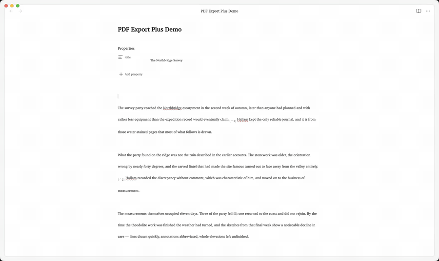
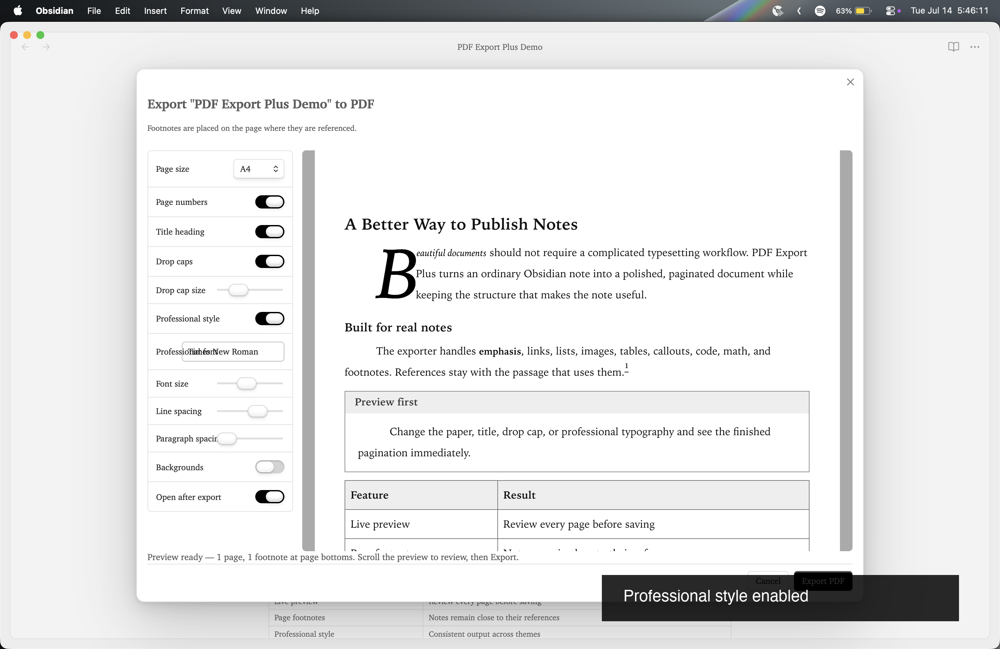

# PDF Export Plus

Export polished PDFs from Obsidian with footnotes at the bottom of the page where they are referenced.

PDF Export Plus renders the active note with Obsidian, shows the fully paginated result before saving, and exports that exact preview. Normal mode preserves your theme and print snippets; Professional style provides consistent, theme-independent typography.



The demo is captured in Obsidian with fictional, purpose-written content. `Option P` is a user-assigned example hotkey; you can assign any available shortcut in Obsidian's Hotkeys settings.



## Highlights

- Page-bottom footnotes instead of a separate endnotes section
- Live, scrollable preview before export
- Links between references and their footnotes
- Images, tables, lists, callouts, code blocks, math, headings, blockquotes, and common Obsidian Markdown
- Optional title generated from `title` frontmatter or the note filename (on by default)
- Paragraph shaping: first-line indents, paragraph spacing, and deliberate blank-line gaps preserved from the note
- An optional font-agnostic drop cap with adjustable size
- Optional Professional style with a searchable list of your installed fonts, plus body size and line spacing
- A4, Letter, Legal, A3, A5, and Tabloid output
- Configurable margins, page numbers, backgrounds, footnote size, and export folder

## Examples

### Footnotes

Write ordinary Obsidian footnotes:

```markdown
The reference stays with the sentence that cites it.[^1]

[^1]: PDF Export Plus places this note at the bottom of the reference's page.
```

### A professional manuscript

Enable **Professional style** in the export preview for a clean manuscript-style PDF. The default preset uses Times New Roman at 12 pt with double spacing. The font field lists the families installed on your computer and accepts any name you type. Change the font, size, or line spacing in **Settings → PDF Export Plus** or directly in the preview.

Professional style deliberately overrides vault typography while retaining document structure. It includes print rules for headings, paragraphs, emphasis, links, lists, tables, blockquotes, callouts, code, math, media, and footnotes. Community-plugin-generated HTML may still need its own print CSS.

### Paragraph shaping

**Paragraph shaping** indents first lines and sets the space between paragraphs; at zero spacing it produces indented, manuscript-style paragraphs. Markdown collapses runs of blank lines, so a wider gap you left between two paragraphs would normally disappear on export — paragraph shaping restores it as a blank line. Professional style switches this on, and you can switch it off again.

### Drop caps

Drop caps are off by default. Enable **Drop caps** and choose a size from two to six lines. The cap inherits the paragraph font, so it works with theme fonts and the Professional style. It also remains upright when the opening word is italicized.

## Usage

1. Open a Markdown note.
2. Open the Command palette.
3. Run **PDF Export Plus: Export to PDF**.
4. Adjust the options and review every page in the preview.
5. Select **Export PDF** and choose a destination.

The title heading is included by default. Turn off **Title heading** in the preview or plugin settings when the note already contains its own title.

## Installation

PDF Export Plus is a desktop-only plugin because PDF creation uses Obsidian's Electron print support.

### Manual installation

1. Download `main.js`, `manifest.json`, and `styles.css` from the latest release.
2. Create `<vault>/.obsidian/plugins/pdf-footnotes/`.
3. Copy all three files into that directory.
4. Reload Obsidian and enable **PDF Export Plus** under **Community plugins**.

The directory name remains `pdf-footnotes` for compatibility with existing installs; the displayed plugin name is PDF Export Plus.

## Settings

| Setting | Purpose |
| --- | --- |
| Page size and margins | Set the physical page geometry. |
| Title heading | Include the frontmatter title or note filename. |
| Paragraph shaping | Indent first lines, set paragraph spacing, and keep blank-line gaps. |
| Drop caps / size | Add and size the opening drop cap. |
| Force professional export | Ignore vault typography and use the professional print preset. |
| Professional typography | Choose font, body size, and line spacing. |
| Page numbers | Show or hide the centered page counter. |
| Print backgrounds | Include theme and element background colors. |
| Footnote font size | Set page-bottom footnote text size. |
| Export folder | Choose the default folder; blank uses Downloads. |
| Open after export | Open the completed PDF automatically. |

## Privacy

Notes are rendered and exported locally. PDF Export Plus does not upload note contents or export files.

## Development

```bash
npm install
npm run build     # production bundle -> main.js
npm run dev       # rebuild on change
npm run typecheck
```

Options set in the export dialog are saved as you change them, so the dialog and the settings tab always agree.

`src/autotest.ts` is a development harness for driving scripted export cycles. It is not wired into the plugin and ships in no release build; see the comment at the top of that file to enable it locally.

## License

GNU Affero General Public License v3.0 or later.
